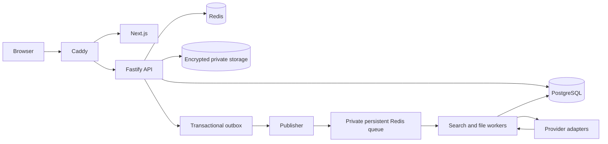
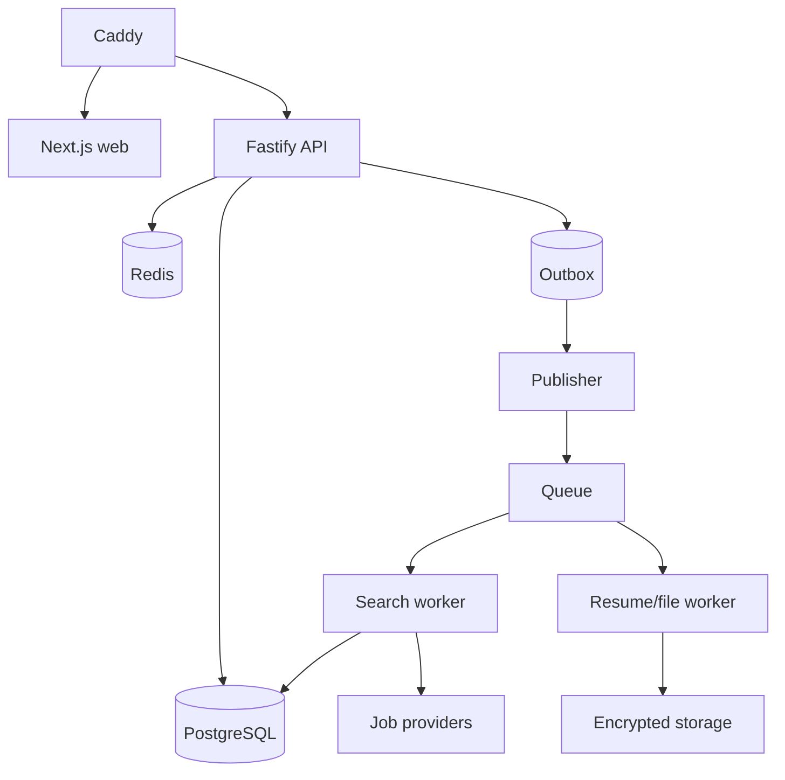
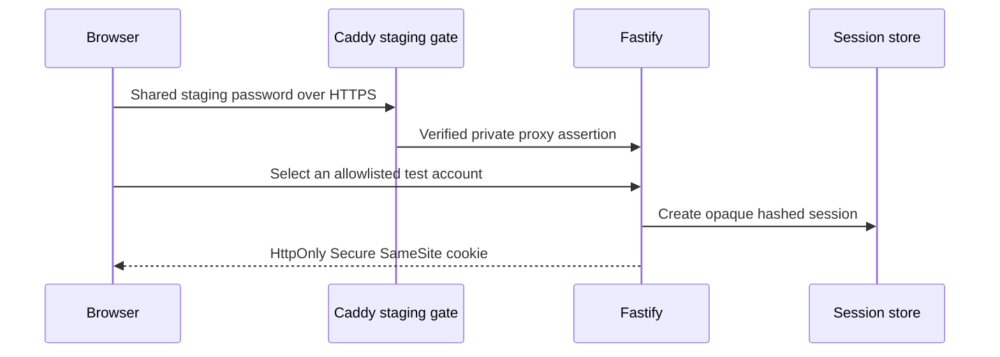
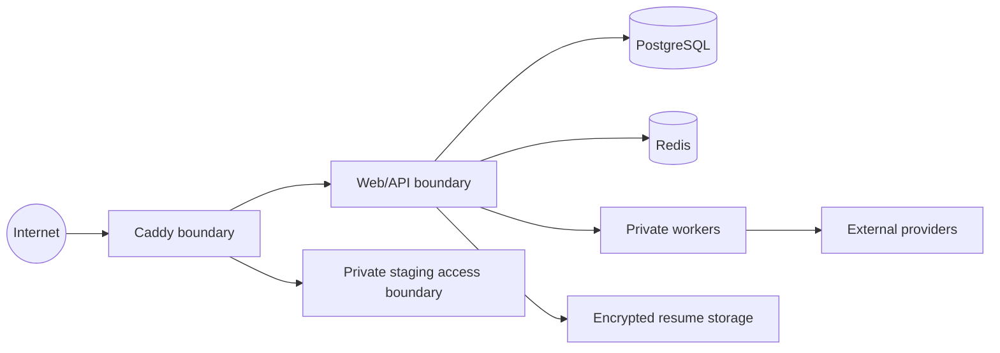

# Architecture

CareerScope is a modular monolith with asynchronous workers. The browser is
served by Next.js and calls Fastify; PostgreSQL is the system of record and
Redis/queues carry bounded asynchronous work.

## System context

## Runtime containers

## Job discovery

```mermaid
flowchart LR
  SearchRequest[User search] --> API
  API --> Tx[Profile/search transaction]
  Tx --> Outbox[Outbox]
  Outbox --> Publisher --> Queue --> Worker[Search worker]
  Worker --> Adapters[Provider adapters]
  Adapters --> Normalize[Normalize and provenance]
  Normalize --> Dedupe[Deduplicate]
  Dedupe --> Match[Deterministic matching]
  Match --> DB[(PostgreSQL)]
  DB --> Stream[SSE/API]
  Stream --> UI[Web UI]
```

## Authentication

## Trust boundaries

Sessions, CSRF/origin checks, owner-derived authorization, rate limiting and
redacted structured logs protect each boundary. Provider integrations are
configuration-gated and never receive session secrets or unnecessary PII.

## Data flow

Profile and preferences plus a private resume produce a frozen matching input.
Searches discover jobs with provenance; deterministic matching produces
explainable evidence. Users save jobs and explicitly record application
history. External application destinations never create a submitted event.
